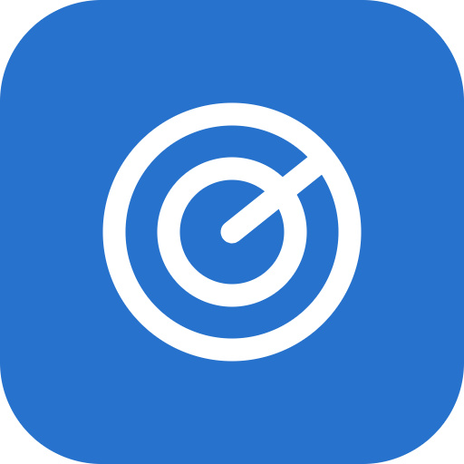
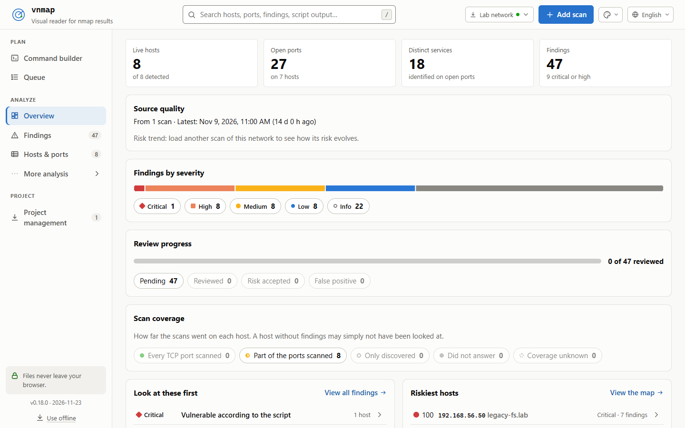
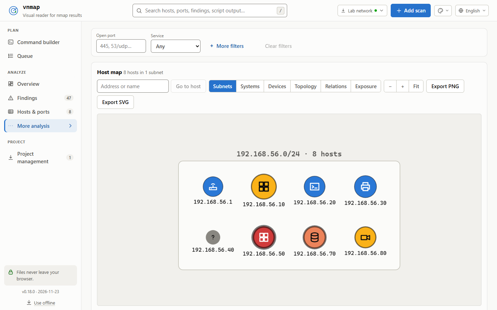
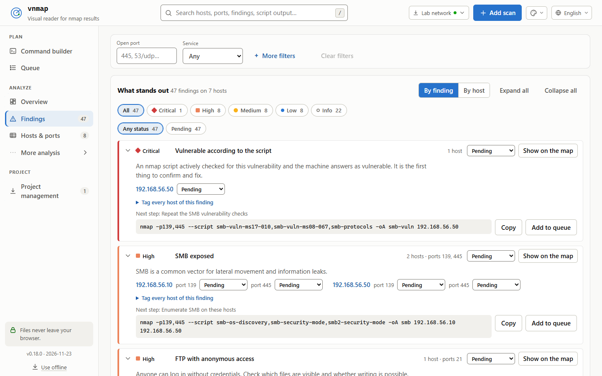
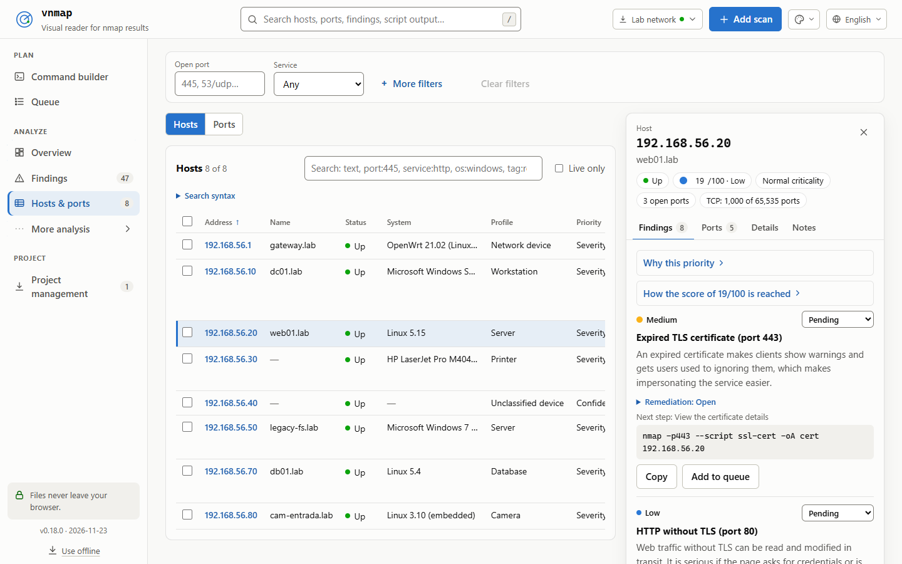
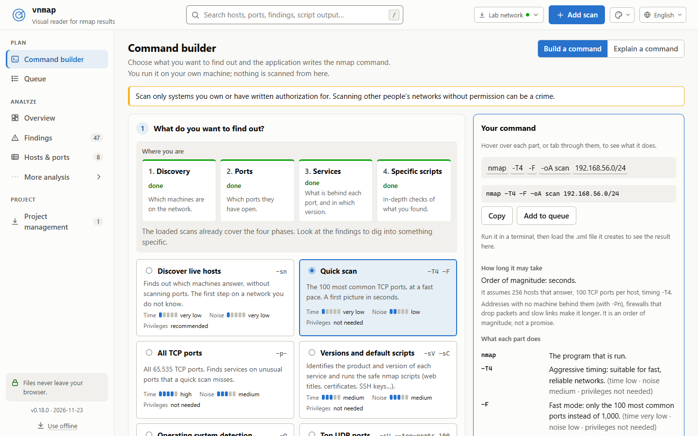
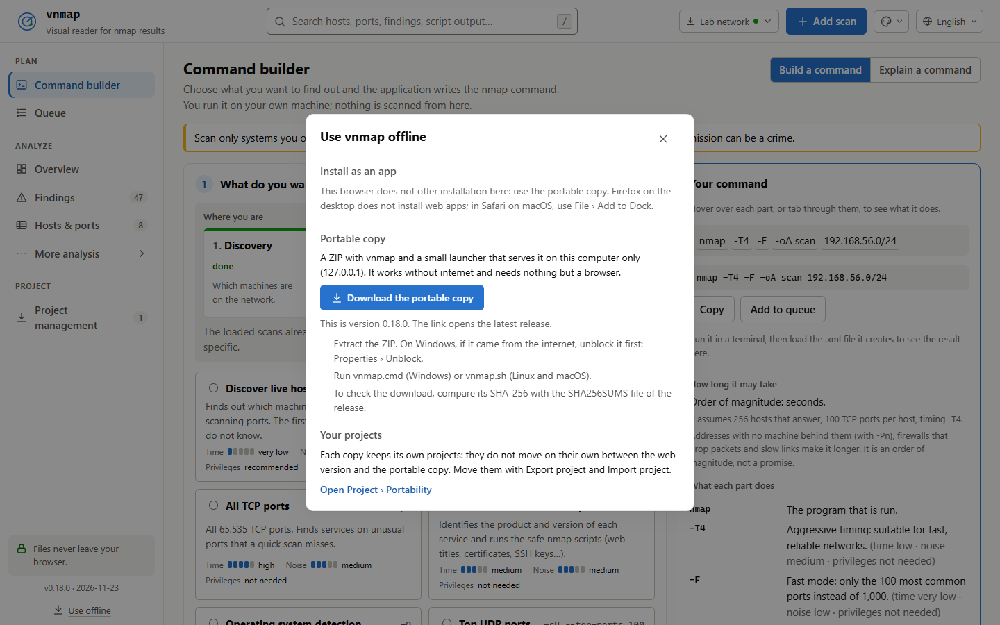

<div align="center">



# vnmap

**Mira qué ha encontrado tu escaneo de nmap.**

Construye comandos de nmap y convierte su salida en un mapa de la red,<br />
una lista priorizada de lo que destaca y el siguiente comando que ejecutar.<br />
Todo se ejecuta en tu navegador: tus escaneos no salen de él.

[](https://github.com/apiraces-hiberuscom/vnmap/releases/latest)
[](LICENSE)
[](#privacidad)
[](#tres-formas-de-usarla)
[](#lo-más-destacado)

### [Abrir la demo »](https://apiraces-hiberuscom.github.io/vnmap/)

[Descargar la copia portable](https://github.com/apiraces-hiberuscom/vnmap/releases/latest) ·
[Instalarla como aplicación](#instalarla-como-aplicación) ·
[English](README.md)

<br />

<picture>
  <source media="(prefers-color-scheme: dark)" srcset="docs/img/overview-dark.png" />
  
</picture>

<sub>Las capturas muestran la interfaz en inglés; la aplicación está también en español, alemán, francés y ruso.</sub>

</div>

<br />

## Por qué vnmap

<table>
  <tr>
    <td width="33%" valign="top">
      <h3>🔒 Privada por diseño</h3>
      Sin servidor y sin peticiones de red. Los escaneos se leen y se guardan en tu navegador, y
      una política de seguridad de contenido estricta garantiza que nada se envía a ningún sitio.
    </td>
    <td width="33%" valign="top">
      <h3>🧭 De la salida al siguiente paso</h3>
      Hosts coloreados por riesgo, hallazgos explicados con palabras sencillas y, para cada uno,
      el comando de nmap que profundiza, listo para copiar.
    </td>
    <td width="33%" valign="top">
      <h3>📦 Funciona en cualquier sitio</h3>
      En línea, instalada como aplicación o como copia portable en un equipo de pruebas sin
      internet. No hay que instalar nada más que un navegador.
    </td>
  </tr>
</table>

## Un ciclo de trabajo

|     | Paso                       | Qué hace vnmap                                                                                                                         |
| :-: | -------------------------- | -------------------------------------------------------------------------------------------------------------------------------------- |
|  1  | **Construir el comando**   | Eliges qué quieres averiguar y obtienes el comando de nmap, con cada opción explicada y un aviso si es lento o ruidoso.                 |
|  2  | **Cargar el resultado**    | Lo ejecutas tú y sueltas la salida (`-oX`, `-oG`, `-oN` o masscan) en la página. Varios ficheros se fusionan por dirección IP.         |
|  3  | **Ver qué destaca**        | Los hosts se puntúan por riesgo, los hallazgos se ordenan por severidad y se ven la cobertura y los cambios entre escaneos.             |
|  4  | **Dar el siguiente paso**  | Cada hallazgo propone el comando que va más allá. Ponlos en cola, exporta un informe y vuelve a empezar.                               |

## Un recorrido rápido

<table>
  <tr>
    <td width="50%" valign="top">
      <picture>
        <source media="(prefers-color-scheme: dark)" srcset="docs/img/map-dark.png" />
        
      </picture>
      <p align="center"><b>Mapa de hosts</b><br /><sub>Por subred, sistema, dispositivo, topología, relaciones o exposición. El color es el riesgo; el tamaño, los puertos abiertos.</sub></p>
    </td>
    <td width="50%" valign="top">
      <picture>
        <source media="(prefers-color-scheme: dark)" srcset="docs/img/findings-dark.png" />
        
      </picture>
      <p align="center"><b>Hallazgos</b><br /><sub>60 reglas integradas, cada una con por qué importa, un estado de revisión y el siguiente comando.</sub></p>
    </td>
  </tr>
  <tr>
    <td width="50%" valign="top">
      <picture>
        <source media="(prefers-color-scheme: dark)" srcset="docs/img/host-dark.png" />
        
      </picture>
      <p align="center"><b>Cada host en detalle</b><br /><sub>Riesgo y su porqué, hallazgos, puertos, servicios, scripts, etiquetas, notas y remediación.</sub></p>
    </td>
    <td width="50%" valign="top">
      <picture>
        <source media="(prefers-color-scheme: dark)" srcset="docs/img/builder-dark.png" />
        
      </picture>
      <p align="center"><b>Constructor de comandos</b><br /><sub>Escenarios, un alcance autorizado y un modo inverso que explica cualquier comando que pegues.</sub></p>
    </td>
  </tr>
</table>

## Lo más destacado

- **Resumen** con las cifras principales, los hallazgos por severidad, el progreso de revisión, la
  cobertura del escaneo, por dónde empezar y los hosts con más riesgo.
- **Riesgo y prioridad explicables** por host: severidad, exposición, criticidad, confianza y
  antigüedad, con el motivo de cada número.
- **Perfiles de activos, anomalías y correlaciones** deducidos en local y mostrados siempre como
  inferencias, nunca como hechos.
- **Escaneos en el tiempo**: una línea base, qué cambió entre dos escaneos y una tendencia compacta
  del riesgo.
- **Vulnerabilidades conocidas** del script `vulners` o de una base CVE que importes (JSON 2.0 de
  la NVD). No se consulta nada en línea.
- **Proyectos** con etiquetas, notas, estado de revisión y seguimiento ligero de la remediación,
  filtros guardados, y exportación e importación.
- **Informes** en HTML (listos para imprimir, con tu portada y tu logo), Markdown, CSV y JSON, y un
  informe comparativo entre dos escaneos.
- **Cinco idiomas** (English, Español, Deutsch, Français, Русский) y **siete temas**, entre ellos
  claro, oscuro y alto contraste.
- **Pensada para teclado y lector de pantalla**, con el mapa disponible también como lista.

## Tres formas de usarla

| Forma                                      | Para qué                                                       | Necesita                                  |
| ------------------------------------------ | -------------------------------------------------------------- | ----------------------------------------- |
| 🌐 **[Demo en línea](https://apiraces-hiberuscom.github.io/vnmap/)** | Probarla y usarla a diario con internet        | Un navegador                              |
| 💻 **[Aplicación instalada](#instalarla-como-aplicación)** | Abrirla como cualquier otra aplicación, también sin conexión | Chrome o Edge                 |
| 📦 **[Copia portable](#copia-portable)**   | Un equipo sin internet, como el de pruebas en casa del cliente | Un navegador (y `python3` en Linux/macOS) |

<div align="center">
  <picture>
    <source media="(prefers-color-scheme: dark)" srcset="docs/img/offline-dark.png" />
    
  </picture>
  <p><sub>Todo está a un clic desde <b>Usar sin conexión</b>, en el pie del lateral.</sub></p>
</div>

### Instalarla como aplicación

En Chrome o Edge, abre la [demo](https://apiraces-hiberuscom.github.io/vnmap/) (o una copia
portable en marcha) y elige **Usar sin conexión › Instalar**, o el icono de instalar de la barra
de direcciones. La aplicación se abre en su propia ventana y funciona sin conexión. Cuando se
publica una versión nueva, te avisa, y solo se actualiza cuando lo aceptas, después de guardar tu
proyecto.

> [!NOTE]
> Firefox de escritorio no instala aplicaciones web: usa la copia portable. En Safari de macOS,
> usa **Archivo › Añadir al Dock**.

### Copia portable

Descarga `vnmap-<versión>-portable.zip` y `SHA256SUMS` de la
[última release](https://github.com/apiraces-hiberuscom/vnmap/releases/latest).

<details open>
<summary><b>Windows</b></summary>
<br />

1. **Desbloquea el ZIP**, porque viene de internet: clic derecho › **Propiedades** › marca
   **Desbloquear** › **Aceptar**. O en PowerShell:
   ```powershell
   Unblock-File .\vnmap-*-portable.zip
   ```
2. Descomprímelo y abre la carpeta `vnmap-<versión>`.
3. Haz doble clic en **`vnmap.cmd`**.

Usa el PowerShell que viene con Windows, no necesita permisos de administrador y no cambia la
política de ejecución del sistema: solo la omite para ese proceso.

</details>

<details open>
<summary><b>Linux y macOS</b></summary>
<br />

```bash
unzip vnmap-*-portable.zip
./vnmap-*/vnmap.sh
```

Necesita `python3`, que tienen casi todos los sistemas. Si no está, el lanzador explica cómo
servir la carpeta `app/` con cualquier servidor estático.

</details>

<details>
<summary><b>Qué hace el lanzador</b></summary>
<br />

- Sirve la carpeta `app/` en <http://127.0.0.1:47821/>, solo en ese equipo: no es accesible desde
  la red.
- Abre ahí el navegador predeterminado y se cierra con `Ctrl+C` o cerrando su ventana.
- Solo atiende `GET` y `HEAD` de ficheros dentro de `app/`: sin listado de carpetas y nada de
  fuera.
- No descarga nada, no escribe fuera de su carpeta y no necesita permisos de administrador.

Si el puerto 47821 está ocupado, se para y lo dice. `--port <n>` elige otro, pero cada dirección
tiene su propio almacén de proyectos (ver más abajo), así que conviene usar siempre el mismo.

</details>

### Verificar la descarga

Compara el SHA-256 del ZIP con el de `SHA256SUMS`:

```powershell
# Windows (PowerShell): el hash debe coincidir con el de SHA256SUMS
Get-FileHash .\vnmap-*-portable.zip -Algorithm SHA256
```

```bash
sha256sum -c SHA256SUMS         # Linux
shasum -a 256 -c SHA256SUMS     # macOS
```

### Pasar proyectos de una copia a otra

Los proyectos se guardan en el navegador, que los separa por dirección. La demo y la copia
portable (y la copia portable en otro puerto) no ven los proyectos de las demás. Para pasar uno,
abre **Gestión del proyecto › Portabilidad** y usa **Exportar proyecto** en una copia e **Importar
proyecto** en la otra.

## Privacidad

- **Sin peticiones de red.** Todo se lee y se guarda en tu navegador. Una política de seguridad
  de contenido estricta (`connect-src 'none'`) lo garantiza: la página no puede enviar tus datos a
  ningún sitio.
- **El contenido de los escaneos se muestra siempre como texto**, nunca se interpreta como HTML:
  los banners y la salida de los scripts los escriben las máquinas escaneadas.
- **Nunca ejecuta nmap.** Solo escribe comandos y lee los ficheros que le das.
- **Build transparente.** Este repositorio publica la aplicación tal como se ejecuta: el
  JavaScript de la rama [`gh-pages`](https://github.com/apiraces-hiberuscom/vnmap/tree/gh-pages) y
  de cada release está minificado, sin ofuscar. El código fuente está en un repositorio aparte.

## Uso responsable

> [!IMPORTANT]
> Escanea solo sistemas propios o que tengas autorización expresa para evaluar. Escanear redes sin
> permiso puede ser ilegal.

vnmap es un proyecto independiente, sin relación con el Nmap Project ni respaldado por él.

## Problemas y sugerencias

Abre un [issue](https://github.com/apiraces-hiberuscom/vnmap/issues). No adjuntes resultados de
escaneos reales: describen la red de alguien.

---

<div align="center">
<sub>Creado por <b>Alejandro Piraces Perez</b> · Publicado con la <a href="LICENSE">licencia MIT</a></sub>
</div>
