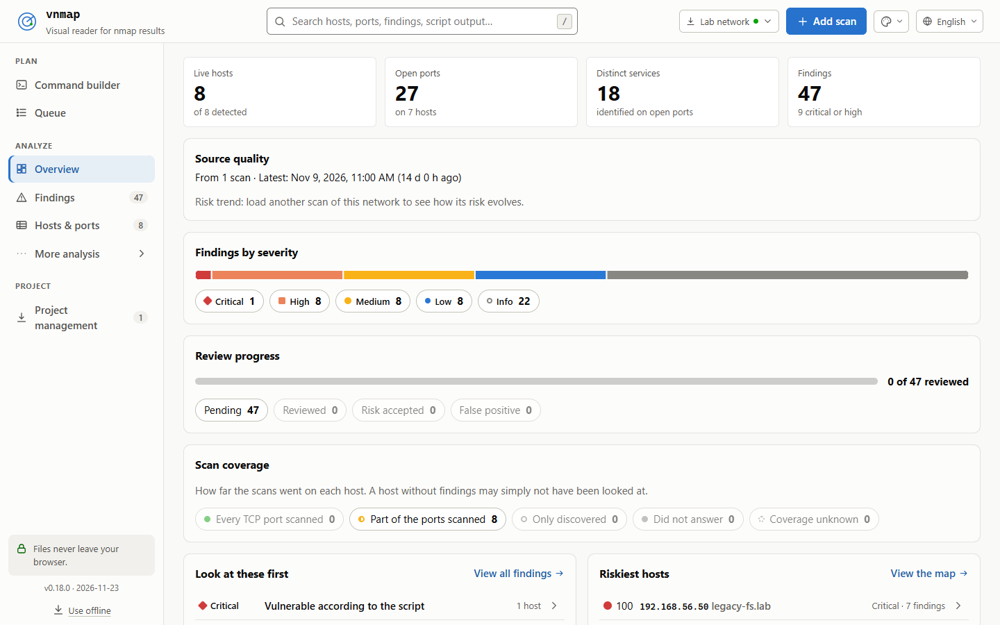
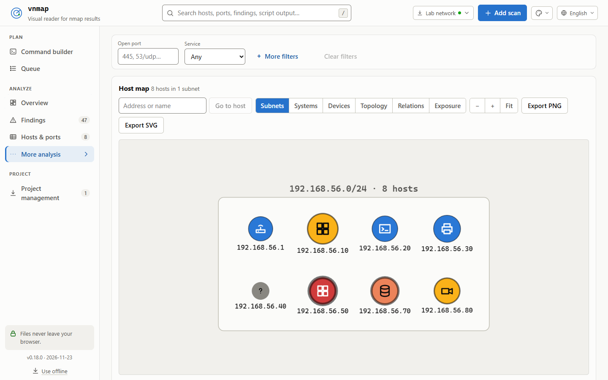
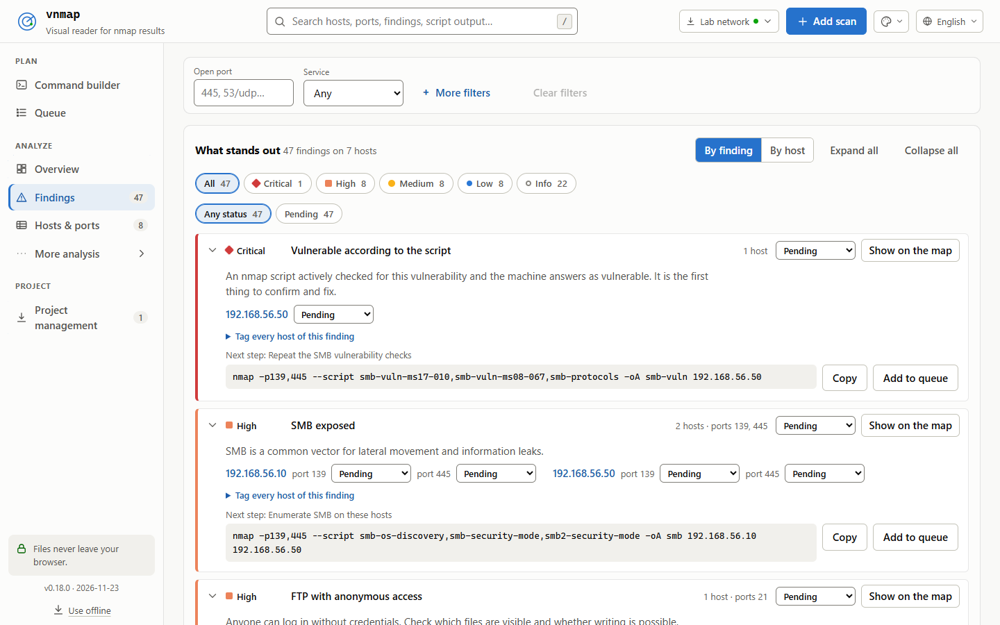
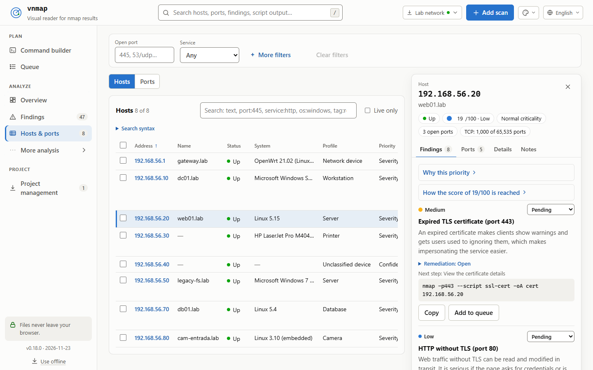
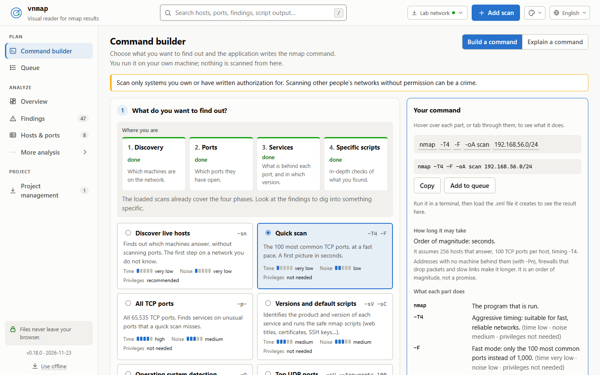
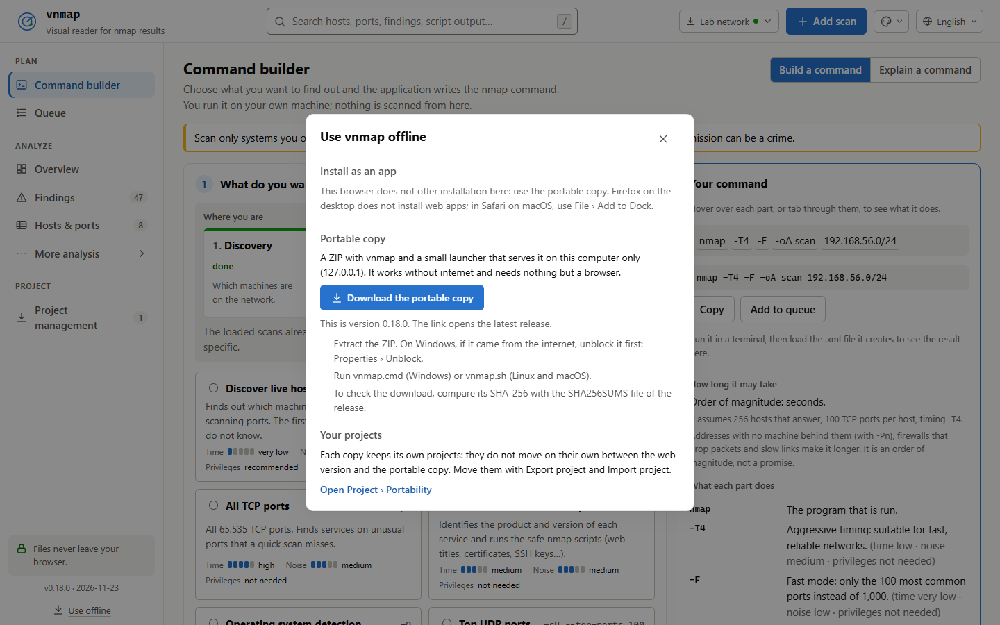

<div align="center">


# vnmap

**See what your nmap scan found.**

Build nmap commands and turn their output into a map of the network,<br />
a prioritized list of what stands out and the next command to run.<br />
Everything runs in your browser: your scans never leave it.

[](https://github.com/apiraces-hiberuscom/vnmap/releases/latest)
[](LICENSE)
[](#privacy)
[](#three-ways-to-use-it)
[](#highlights)

### [Open the live demo »](https://apiraces-hiberuscom.github.io/vnmap/)

[Download the portable copy](https://github.com/apiraces-hiberuscom/vnmap/releases/latest) ·
[Install it as an app](#install-it-as-an-app) ·
[Español](README.es.md)

<br />

<picture>
  <source media="(prefers-color-scheme: dark)" srcset="docs/img/overview-dark.png" />
  
</picture>

</div>

<br />

## Why vnmap

<table>
  <tr>
    <td width="33%" valign="top">
      <h3>🔒 Private by design</h3>
      No backend and no network requests. Scans are read and kept in your browser, and a strict
      Content Security Policy makes sure nothing is sent anywhere.
    </td>
    <td width="33%" valign="top">
      <h3>🧭 From output to next step</h3>
      Hosts coloured by risk, findings explained in plain language, and for each one the nmap
      command that digs deeper, ready to copy.
    </td>
    <td width="33%" valign="top">
      <h3>📦 Works anywhere</h3>
      Online, installed as an app, or as a portable copy on a test machine with no internet.
      Nothing to install but a browser.
    </td>
  </tr>
</table>

## One working cycle

|     | Step                   | What vnmap does                                                                                                                    |
| :-: | ---------------------- | ---------------------------------------------------------------------------------------------------------------------------------- |
|  1  | **Build the command**  | Choose what you want to find out and get the nmap command, with every option explained and a warning when it is slow or noisy.     |
|  2  | **Load the result**    | Run it yourself and drop the output (`-oX`, `-oG`, `-oN`, or masscan) into the page. Several files are merged by IP address.       |
|  3  | **See what stands out** | Hosts are scored by risk, findings sorted by severity, coverage and changes between scans made visible.                           |
|  4  | **Take the next step** | Every finding suggests the command that goes further. Queue them, export a report, and start again.                                |

## A quick tour

<table>
  <tr>
    <td width="50%" valign="top">
      <picture>
        <source media="(prefers-color-scheme: dark)" srcset="docs/img/map-dark.png" />
        
      </picture>
      <p align="center"><b>Host map</b><br /><sub>By subnet, system, device, topology, relations or exposure. Colour is risk, size is open ports.</sub></p>
    </td>
    <td width="50%" valign="top">
      <picture>
        <source media="(prefers-color-scheme: dark)" srcset="docs/img/findings-dark.png" />
        
      </picture>
      <p align="center"><b>Findings</b><br /><sub>60 built-in rules, each with why it matters, a review status and the next command.</sub></p>
    </td>
  </tr>
  <tr>
    <td width="50%" valign="top">
      <picture>
        <source media="(prefers-color-scheme: dark)" srcset="docs/img/host-dark.png" />
        
      </picture>
      <p align="center"><b>Every host in detail</b><br /><sub>Risk and why, findings, ports, services, scripts, tags, notes and remediation.</sub></p>
    </td>
    <td width="50%" valign="top">
      <picture>
        <source media="(prefers-color-scheme: dark)" srcset="docs/img/builder-dark.png" />
        
      </picture>
      <p align="center"><b>Command builder</b><br /><sub>Scenarios, an authorized scope and a reverse mode that explains any command you paste.</sub></p>
    </td>
  </tr>
</table>

## Highlights

- **Overview** with the headline figures, findings by severity, review progress, scan coverage,
  what to look at first and the riskiest hosts.
- **Explainable risk and priority** per host: severity, exposure, criticality, confidence and age,
  with the reason behind every number.
- **Asset profiles, anomalies and correlations** inferred locally, always shown as inferences,
  never as facts.
- **Scans over time**: a baseline, what changed between two scans, and a compact risk trend.
- **Known vulnerabilities** from the `vulners` script or from a CVE base you import (NVD JSON
  2.0). Nothing is looked up online.
- **Projects** with tags, notes, review status and light remediation tracking, saved filters, and
  export and import.
- **Reports** in HTML (print-ready, with your cover and logo), Markdown, CSV and JSON, plus a
  comparison report between two scans.
- **Five languages** (English, Español, Deutsch, Français, Русский) and **seven themes**, light,
  dark and high contrast among them.
- **Keyboard and screen reader friendly**, with the map also available as a list.

## Three ways to use it

| Way                                     | Best for                                                    | Needs                                    |
| --------------------------------------- | ----------------------------------------------------------- | ---------------------------------------- |
| 🌐 **[Online demo](https://apiraces-hiberuscom.github.io/vnmap/)** | Trying it, everyday use with internet         | A browser                                |
| 💻 **[Installed app](#install-it-as-an-app)** | Opening it like any other app, also offline           | Chrome or Edge                           |
| 📦 **[Portable copy](#portable-copy)**  | A computer with no internet, such as a test machine on site | A browser (and `python3` on Linux/macOS) |

<div align="center">
  <picture>
    <source media="(prefers-color-scheme: dark)" srcset="docs/img/offline-dark.png" />
    
  </picture>
  <p><sub>Everything is one click away from <b>Use offline</b>, in the sidebar footer.</sub></p>
</div>

### Install it as an app

In Chrome or Edge, open the [demo](https://apiraces-hiberuscom.github.io/vnmap/) (or a running
portable copy) and choose **Use offline › Install**, or the install icon in the address bar. The
app opens in its own window and works without a connection. When a new version is published, it
tells you, and updates only when you accept, after saving your project.

> [!NOTE]
> Firefox on the desktop cannot install web apps: use the portable copy. In Safari on macOS, use
> **File › Add to Dock**.

### Portable copy

Download `vnmap-<version>-portable.zip` and `SHA256SUMS` from the
[latest release](https://github.com/apiraces-hiberuscom/vnmap/releases/latest).

<details open>
<summary><b>Windows</b></summary>
<br />

1. **Unblock the ZIP**, since it came from the internet: right-click it › **Properties** › tick
   **Unblock** › **OK**. Or, in PowerShell:
   ```powershell
   Unblock-File .\vnmap-*-portable.zip
   ```
2. Extract it and open the `vnmap-<version>` folder.
3. Double-click **`vnmap.cmd`**.

It uses the PowerShell that comes with Windows, needs no administrator rights and does not change
the system execution policy: it only bypasses it for that one process.

</details>

<details open>
<summary><b>Linux and macOS</b></summary>
<br />

```bash
unzip vnmap-*-portable.zip
./vnmap-*/vnmap.sh
```

It needs `python3`, which most systems have. Without it, the launcher explains how to serve the
`app/` folder with any static web server.

</details>

<details>
<summary><b>What the launcher does</b></summary>
<br />

- Serves the `app/` folder at <http://127.0.0.1:47821/>, on that computer only: it is not
  reachable from the network.
- Opens your default browser there, and stops with `Ctrl+C` or by closing its window.
- Answers only `GET` and `HEAD` for files inside `app/`: no directory listing, nothing outside.
- Downloads nothing, writes nothing outside its folder and needs no administrator rights.

If port 47821 is in use, it stops and says so. `--port <n>` chooses another one, but each address
has its own project store (see below), so keep using the same port.

</details>

### Verify the download

Compare the SHA-256 of the ZIP with the one in `SHA256SUMS`:

```powershell
# Windows (PowerShell): the hash must match the one in SHA256SUMS
Get-FileHash .\vnmap-*-portable.zip -Algorithm SHA256
```

```bash
sha256sum -c SHA256SUMS         # Linux
shasum -a 256 -c SHA256SUMS     # macOS
```

### Moving projects between copies

Projects are saved in the browser, and browsers keep them separately for each address. The demo
and the portable copy (and the portable copy on another port) do not see each other's projects.
To move one, open **Project management › Portability** and use **Export project** in one copy and
**Import project** in the other.

## Privacy

- **No network requests.** Everything is parsed and stored in your browser. A strict Content
  Security Policy (`connect-src 'none'`) enforces it: the page cannot send your data anywhere.
- **Scan content is always shown as text**, never interpreted as HTML: banners and script output
  are written by the machines that were scanned.
- **It never runs nmap.** It only writes commands and reads the files you give it.
- **Transparent build.** This repository publishes the application exactly as it runs: the
  JavaScript in the [`gh-pages`](https://github.com/apiraces-hiberuscom/vnmap/tree/gh-pages)
  branch and in each release is minified, not obfuscated. The source code is kept in a separate
  repository.

## Responsible use

> [!IMPORTANT]
> Scan only systems you own or are explicitly authorized to test. Scanning networks without
> permission can be illegal.

vnmap is an independent project. It is not affiliated with or endorsed by the Nmap Project.

## Problems and suggestions

Open an [issue](https://github.com/apiraces-hiberuscom/vnmap/issues). Please do not attach real
scan results: they describe someone's network.

---

<div align="center">
<sub>Created by <b>Alejandro Piraces Perez</b> · Released under the <a href="LICENSE">MIT License</a></sub>
</div>
